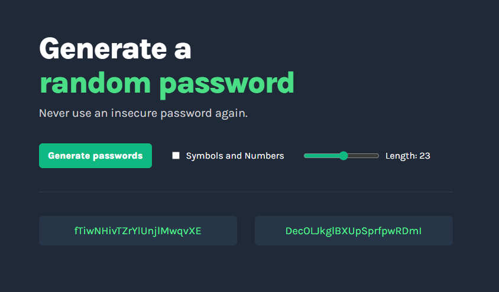

# 🔐 Password Generator

A small web app that generates two random passwords in one click, with an adjustable length and copy-to-clipboard.

Solo project from the [Scrimba Fullstack Developer Path](https://scrimba.com/fullstack-path-c0fullstack) (*JavaScript Fundamentals* module), built from a Figma design provided by Scrimba.

**🌐 Live demo:** [Scrimba Password Generator](https://scrimpasswordgenerator.netlify.app)



## ✨ Features

- Generates **two random passwords** at the click of a button
- **Adjustable length** from 15 to 30 characters with a slider
- **Symbols and numbers** toggle: letters only, or letters, numbers and symbols
- **Click a password to copy it** to the clipboard
- Dark theme based on the Figma design

## 🛠️ Built with

- HTML5
- CSS3 (Flexbox, Google Fonts: Karla)
- Vanilla JavaScript (no framework, no library)

## 🧠 What I practiced

- Generating random values with `Math.random()` and `Math.floor()`
- Picking a random item from an array with `array.length`
- Building a string character by character with `for` loops
- Reading form inputs: checkbox (`checked`) and range slider (`value`)
- Updating the DOM with `textContent`
- Using the Clipboard API (`navigator.clipboard.writeText`)
- Turning a Figma design into HTML and CSS

## 🚀 Run it locally

```bash
git clone https://github.com/Hushhhy/simplePasswordGenerator.git
cd simplePasswordGenerator
```

Then open `index.html` in your browser. No installation needed.

## 📁 Project structure

```
simplePasswordGenerator/
├── index.html
├── style.css
├── script.js
└── assets
    └── screenshot.png
```

## 🙏 Credits

- Project brief and design: [Scrimba](https://scrimba.com)
- Built by [Alexis Carpentier](https://github.com/Hushhhy)